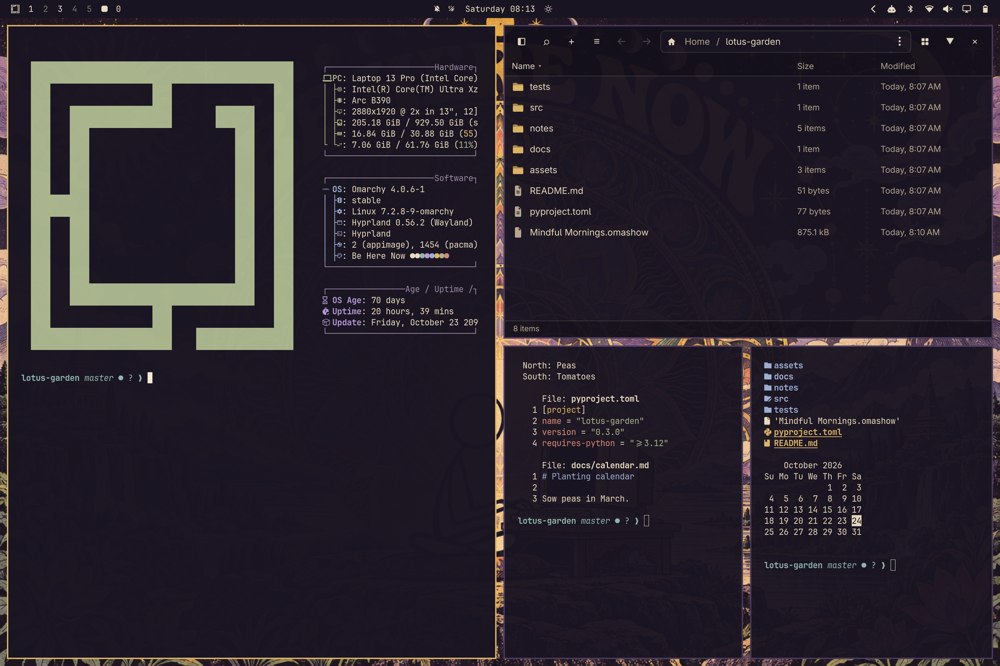
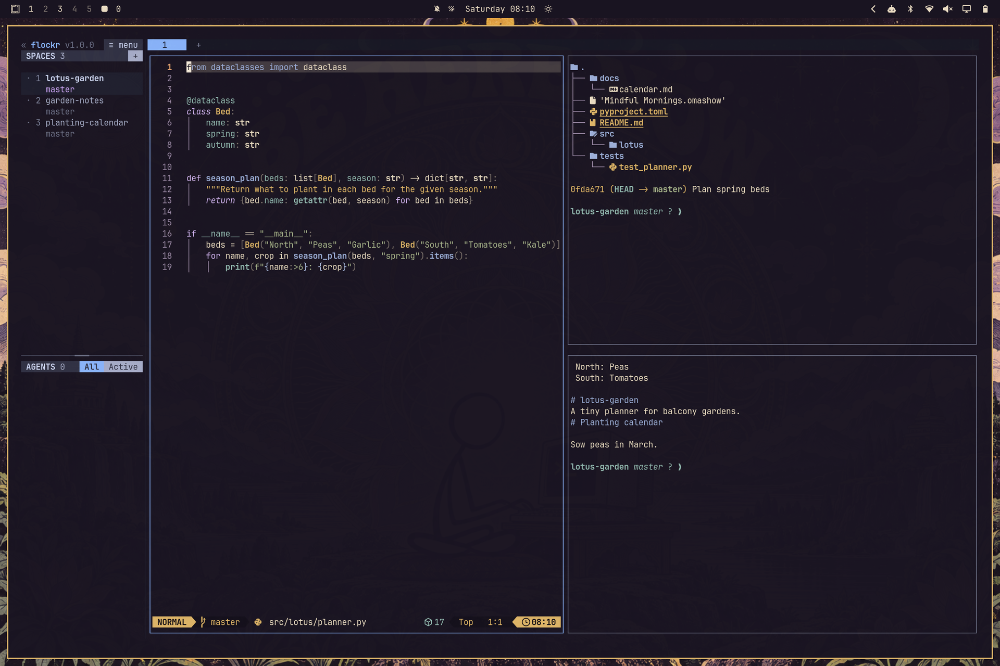
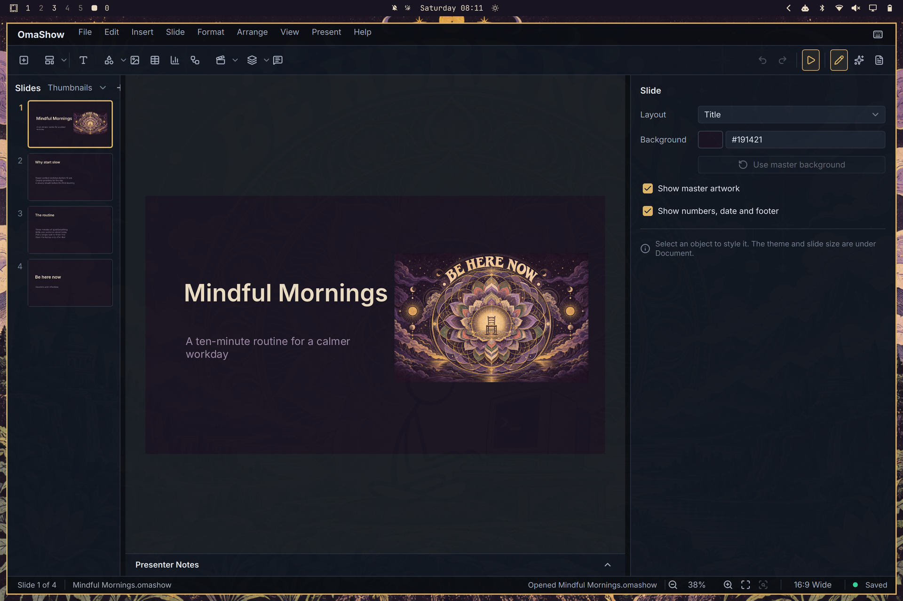
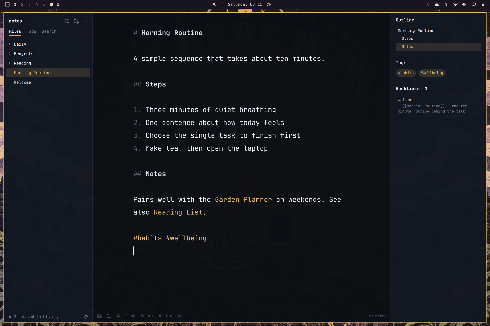
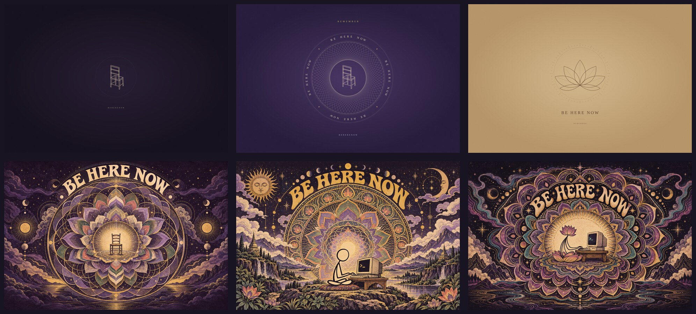

# Be Here Now for Omarchy

A dark [Omarchy](https://omarchy.org) theme inspired by Ram Dass's *Be Here Now*:
violet ink, warm paper, and saffron accents, with six original wallpapers of
chairs, mandalas, and a meditating figure at a CRT terminal.



## Screenshots

| | |
| --- | --- |
|  |  |
| **Flockr** with Neovim, a file tree, and a shell | **OmaShow** editing a presentation |
|  |  |
| **OmaZettel** with a note, outline, tags, and backlinks | **fastfetch**, **Omanta**, and two terminals |

## The look

- Deep violet base (`#191421`) with warm paper text (`#EADCC3`).
- Saffron (`#DDB568`) for the accent, cursor, and active window border.
- Plum selections (`#49365F`) that keep text readable in terminals and editors.
- Soft, warm ANSI colors: red, green, and yellow stay distinct for errors,
  success, and warnings.
- `Yaru-yellow` icons.
- Six wallpapers and an optional pixel-dissolve screensaver.

| Role | Color |
| --- | --- |
| Background | `#191421` |
| Foreground (paper) | `#EADCC3` |
| Accent (saffron) | `#DDB568` |
| Selection (plum) | `#49365F` |
| Muted (lavender) | `#9B8AA6` |
| Magenta | `#B49AD8` |
| Green (sage) | `#A9B58D` |
| Red (clay) | `#D88978` |

The palette in `colors.toml` drives Omarchy's generated terminal, editor,
shell, and app themes. Your fonts, layout, and animation settings stay as they
are.

## Install

```sh
omarchy theme install https://github.com/mcsmith3/omarchy-be-here-now-theme
omarchy theme set be-here-now
```

To pick up changes later, run `omarchy theme update`.

## Wallpapers



| File | Description |
| --- | --- |
| `01-chair.png` | A single hand-drawn chair on deep violet. |
| `02-mandala.png` | The chair inside a ring of type and fine line work. |
| `03-brown-paper.png` | A lotus on warm brown paper. |
| `04-cosmic-mandala.png` | An empty chair inside a large psychedelic mandala. |
| `05-lotus-pose-terminal.png` | A stick figure in lotus pose at a CRT terminal. |
| `06-lotus-terminal.png` | A lotus-shaped figure at a CRT terminal. |

Cycle through them with `omarchy theme bg next`.

The first three are 3840 × 2560 vector renders. Their editable SVGs and the
script that draws them are in `artwork/`; rebuild them with
`python artwork/render.py` (needs `rsvg-convert` from `librsvg`). The other
three are 1536 × 1024 illustrations made with an image-generation model; their
full prompts are in `artwork/psychedelic-prompts.json`.

All the artwork is original. None of it is scanned or copied from the book.

## Pixel-dissolve screensaver

This is optional. The six wallpapers take turns on screen: each one dissolves
in from coarse pixels over about three seconds, holds in full detail for twelve
seconds, then dissolves back out over deep plum before the next one arrives.

```sh
python3 "$(omarchy theme dir be-here-now)/scripts/install-screensaver.py" --check
python3 "$(omarchy theme dir be-here-now)/scripts/install-screensaver.py"
omarchy restart shell
~/.local/share/omarchy-be-here-now/launch-screensaver --preview
```

The installer copies the saver to `~/.local/share/omarchy-be-here-now/` and
routes Omarchy's idle screensaver through a small theme-aware dispatcher in
`~/.local/share/omarchy-theme-screensaver/`. While another theme is active, you
get the stock Omarchy screensaver. On first install it clones the `omarchy.idle`
plugin to point it at the dispatcher, then asks you to restart the shell. If
another theme has already set up the dispatcher, it just adds a Be Here Now
entry and no restart is needed. It backs up everything it changes to
`~/.local/state/omarchy/backups/`.

It keeps Omarchy's own idle and lock timing and the screensaver-off toggle. Any
key, mouse movement, click, or scroll dismisses it.

Set `BE_HERE_NOW_PREVIEW_SECONDS=30` to have a preview close itself after 30
seconds. Rerun the installer after you edit the screensaver or the wallpapers.
The shader is `screensaver/pixel-dissolve.frag`; rebuild it after edits with:

```sh
/usr/lib/qt6/bin/qsb --glsl '100 es,120,150' --hlsl 50 --msl 12 \
  -o screensaver/pixel-dissolve.frag.qsb screensaver/pixel-dissolve.frag
```

## Make it yours

`colors.toml` is the palette source and `icons.theme` names the icon theme.
Re-apply the theme after an edit with `omarchy theme set be-here-now`.

## License

[MIT](LICENSE). *Be Here Now* is a book by Ram Dass. This theme is a fan
tribute and is not affiliated with or endorsed by Ram Dass, the Love Serve
Remember Foundation, or the book's publishers.
